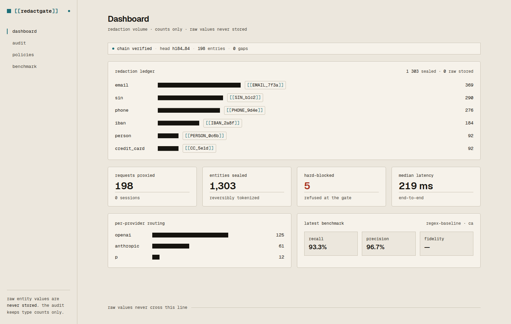

# RedactGate

> **Live console: [redactgate.mmix.biz](https://redactgate.mmix.biz)** (sign up, create a firm, run the playground) · **Landing: [redactgate.pages.dev](https://redactgate.pages.dev)** · A self-hosted PII / financial-redaction firewall that lets regulated businesses use **any** cloud LLM without ever leaking raw client data.

RedactGate sits between your staff and every cloud LLM. It strips, **reversibly tokenizes**, and audits every sensitive entity before the API call leaves your perimeter — then re-inflates the model's answer on the way back. One drop-in OpenAI-compatible endpoint. AGPL-3.0. `docker compose up`.

```
Client (OpenAI SDK / Cursor / LibreChat)  ──base_url=http://localhost:8088/v1──▶  RedactGate
   detect (regex packs + Presidio + optional LLM-NER)  →  reversibly tokenize (AES-256-GCM vault)
   →  forward sanitized payload to AI_PROVIDER  →  re-inflate response  →  hash-chained audit
```



**Landing page:** a self-contained marketing site lives in [`site/index.html`](site/index.html) (deploy to any static host). A launch kit is in [`docs/LAUNCH.md`](docs/LAUNCH.md).

## Build North (Oct 16–25, 2026): what was added this week

The gateway core (detection, vault, audit chain, provider adapters) was written in June 2026.
During Build North it became something a firm can sign in to and trust with Claude:

- **Clerk sign-in for the console.** Before this the console had no login, and an internal
  `/api/proxy` route handed the server's admin token to anyone who could reach it. Now every
  route needs a Clerk session; a **firm is a Clerk organization**, mapped server-side to a
  RedactGate tenant; roles **admin / compliance officer / member** gate the playground,
  policies and the audit trail (checked in server code, not just hidden in the nav).
- **Claude as the cloud model**, default `claude-opus-5-5`: the Anthropic adapter now speaks the
  current Messages API (no sampling params on 5.x, effort mapping, refusals, in-stream errors,
  token usage on streams).
- **Playground with an explain view**: paste a synthetic client note and see the original with
  detected values, the exact payload Claude received, Claude's raw answer with placeholders,
  the answer with values restored, and the counts-only audit row that was written.
- **Detection gaps closed** after a first live run, where the SIN, OHIP number, bank account,
  address and names reached Claude in clear text (Claude pointed it out). Added cue-anchored
  SIN, health cards, bank transit/account, postal codes, street addresses, case-insensitive DOB,
  policy/claim numbers; Presidio no longer tokenizes "this year" or "six weeks". On the three
  synthetic notes in the playground (27 sensitive values), the June default caught 6; the
  Build North config catches 26 (an employer name is still missed).
- **LLM-NER stays local**: the optional LLM entity pass reads raw text, so it now runs on a
  local model by default and refuses a cloud provider unless explicitly allowed.
- **Policy-safe fallback**: `AI_FALLBACK_PROVIDERS=ollama` retries on a local model when Claude
  fails, but never on a provider the firm's policy does not allow.
- **Tenant-scoped admin API** (`/admin/tenants/resolve`, `/admin/teams/{id}/…`, playground
  with a per-team daily cap) and hash-chain verification shown on the dashboard.

Submission write-up: [`docs/build-north/SUBMISSION.md`](docs/build-north/SUBMISSION.md).

## Why it exists

A tax associate pasting a client's bank statement into ChatGPT has no safe alternative. RedactGate is that alternative: the raw PII never crosses the wire, redacted entities are reversibly tokenized in a local vault, **referential consistency** is preserved so answer quality survives, and every request is logged (entity *counts* only, never values) for a compliance officer to defend in an audit.

## Features (MVP)

- **Drop-in OpenAI-compatible proxy** — `POST /v1/chat/completions`, `/v1/responses`. The provider behind it is chosen by config, not the caller.
- **Multi-pass redaction engine** — regex jurisdiction packs + Presidio/spaCy + optional structured LLM-NER, merged by a confidence-weighted resolver.
- **Reversible token vault** — `Acme Ltd → [[ORG_7f3a]]`, AES-256-GCM, per-session DEK, referential consistency (same value → same placeholder within a session).
- **Stream-safe re-inflation** — placeholders are swapped back mid-SSE-stream, never emitted half-substituted.
- **Per-jurisdiction packs** — CA (SIN/BN/GST/NEQ), US (SSN/EIN/ITIN), EU (IBAN/VAT), UA (EDRPOU/ІПН), IRCC (UCI) — en/uk/ru/fr aware.
- **Hash-chained audit log** — append-only, zero-raw-value, one-click compliance export.
- **Policy engine** — tokenize / mask / hard-block per team & route; provider allow-lists.
- **Multi-provider gateway** — `AI_PROVIDER` ∈ anthropic (default model `claude-opus-5-5`), openai, gemini, azure, bedrock, do-genai, ollama; optional policy-safe fallback chain.
- **Fidelity benchmark** — golden-set recall + LLM-judge answer-fidelity scorecard. Measured (qwen2.5, fully local): detection recall 73–96% / precision 85–93%, and **~77% mean answer-fidelity** on the redact→answer→re-inflate round-trip — frontier models score higher.
- **Local fallback** — `AI_PROVIDER=ollama` + regex/Presidio-only = fully air-gapped, no cloud, no key.

## Quickstart

```bash
cp .env.example .env
# generate the three 32-byte keys:
python -c "import os,base64;print('VAULT_MASTER_KEY='+base64.b64encode(os.urandom(32)).decode())" >> .env
python -c "import os,base64;print('FINGERPRINT_HMAC_KEY='+base64.b64encode(os.urandom(32)).decode())" >> .env
python -c "import os,base64;print('AUDIT_HMAC_KEY='+base64.b64encode(os.urandom(32)).decode())" >> .env

docker compose up -d            # postgres + redis + api + worker
# air-gapped local model:  docker compose --profile ollama up -d
# admin UI:                docker compose --profile web up -d   # http://localhost:3088
```

Point any OpenAI client at it:

```bash
curl http://localhost:8088/v1/chat/completions \
  -H "Authorization: Bearer $REDACTGATE_API_KEY" \
  -H "Content-Type: application/json" \
  -d '{"model":"gpt-4o-mini","messages":[{"role":"user","content":"Summarize: SIN 193 456 787, jane@example.com."}]}'
# upstream sees [[SIN_xxxx]] / [[EMAIL_xxxx]] — you get the real answer back.
```

## Local development

```bash
python -m venv .venv && . .venv/bin/activate
pip install -e ".[dev]"          # add ".[dev,ner]" for Presidio
pytest                            # unit lane: no DB needed
RUN_INTEGRATION=1 pytest -m integration   # needs a live Postgres
uvicorn app.main:app --reload --port 8000
```

## Architecture

| Layer | Choice |
|---|---|
| Proxy / API | FastAPI (async streaming, OpenAI-schema parity) |
| Detection | regex packs + Presidio/spaCy + optional LLM-NER |
| Vault & audit | Postgres 16, AES-256-GCM, hash-chained append-only audit |
| Gateway | multi-provider adapter (`AI_PROVIDER` switch) |
| Admin UI | Next.js 15 (App Router) + Tailwind, Clerk (organizations + roles) |
| Queue / eval | arq (Redis) for async fidelity runs |
| License | AGPL-3.0 |

See [`AGENTS.md`](AGENTS.md) for the module map and the contract between components, and `migrations/001_init.sql` for the canonical schema.

## Security

RedactGate is a privacy firewall — see [docs/SECURITY.md](docs/SECURITY.md) for the threat model and the (fixed) findings from the 2026-06-20 adversarial audit.

## License

AGPL-3.0-or-later. Commercial / AGPL-exemption licensing available for closed deployments — see `LICENSE`.
